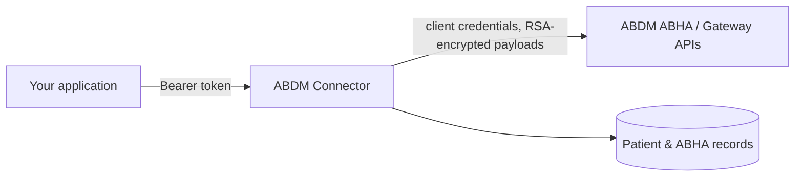

# Introduction

The ABDM Connector is a REST API that wraps the [Ayushman Bharat Digital Mission (ABDM)](https://abdm.gov.in) gateway. Your application calls the connector, and the connector handles:

- getting and refreshing ABDM gateway sessions
- RSA-encrypting Aadhaar numbers and OTPs before sending them to ABDM
- the `REQUEST-ID` and `TIMESTAMP` headers ABDM requires
- storing ABHA tokens, linked ABHA addresses and audit logs against your patient
- limiting how many OTP attempts are allowed per identifier

Your application only handles patient data and user interaction. It never stores ABDM client credentials.

## How it fits



## Base URL

All paths in these docs are relative to the connector base URL:

```
https://<connector-host>/authservice/api/v1
```

Ask the connector team for the **sandbox** and **production** hostnames. Sandbox calls go to the ABDM sandbox. Use only ABDM test identities there.

## Modules {#modules}

| Module | What it covers | Status |
|---|---|---|
| [M1 · ABHA](/m1/overview) | Create, find, verify and link ABHA | Documented |
| M2 · HIP | Care-context linking, sharing health records | Coming soon |
| M3 · HIU | Consent requests, fetching health records | Coming soon |
| M4 · HPR / HFR | Professional and facility registries | Coming soon |

## Before your first call

1. Get a connector user account for your application from the connector team.
2. [Get an access token](/guide/authentication).
3. Read the [response format](/guide/response-format). The connector reports errors **inside the response body**, so you can't rely on the HTTP status code alone.
4. Start with [M1 · ABHA](/m1/overview).
