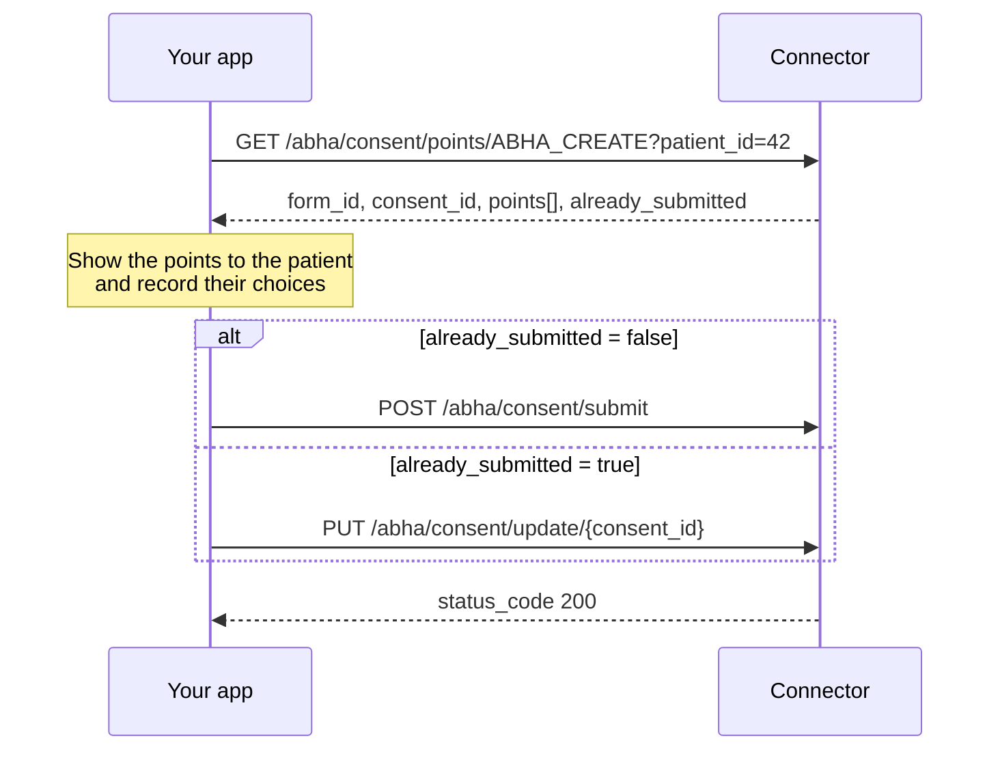

# Patient consent

ABDM requires the patient's informed consent before you create or link an ABHA for them. The connector keeps the consent text (the **consent points**) and records which points the patient accepted.



## 1. Get the consent form

<EndpointBadge method="GET" path="/abha/consent/points/{form_code}" />

| Parameter | In | Required | Description |
|---|---|---|---|
| `form_code` | path | yes | `ABHA_CREATE` for M1 |
| `patient_id` | query | yes | Patient to fetch the consent state for |

**Response `data[0]`**

| Field | Description |
|---|---|
| `form_id` | ID of the consent form. Send it back as `consent_form_id`. |
| `consent_id` | ID of the patient's existing consent, if any. Used for updates. |
| `already_submitted` | `true` if this patient has already given consent. |
| `points[]` | Consent statements. Each has an `id`, its text, and whether it's already accepted. |

<ApiPlayground
  method="GET"
  path="/abha/consent/points/{form_code}"
  :params="[
    { name: 'form_code', in: 'path', required: true, placeholder: 'ABHA_CREATE' },
    { name: 'patient_id', in: 'query', required: true, placeholder: '42' },
  ]"
/>

## 2. Submit consent

<EndpointBadge method="POST" path="/abha/consent/submit" />

**JSON body**

```json
{
  "patient_id": 42,
  "consent_form_id": 7,
  "responses": [
    { "consent_point_id": 101, "accepted": true },
    { "consent_point_id": 102, "accepted": true },
    { "consent_point_id": 103, "accepted": false }
  ]
}
```

Send one entry in `responses` for **every** point, including the ones the patient declined.

<ApiPlayground
  method="POST"
  path="/abha/consent/submit"
  :body="{ patient_id: 42, consent_form_id: 7, responses: [{ consent_point_id: 101, accepted: true }] }"
/>

## 3. Update consent

If `already_submitted` is `true`, update the existing consent instead of submitting a new one.

<EndpointBadge method="PUT" path="/abha/consent/update/{consent_id}" />

The JSON body has the same shape as **Submit consent**.

## Read a patient's consent

<EndpointBadge method="GET" path="/abha/consent/patient/{patient_id}" />

Returns the consent records stored for the patient, for audits or to display them.
