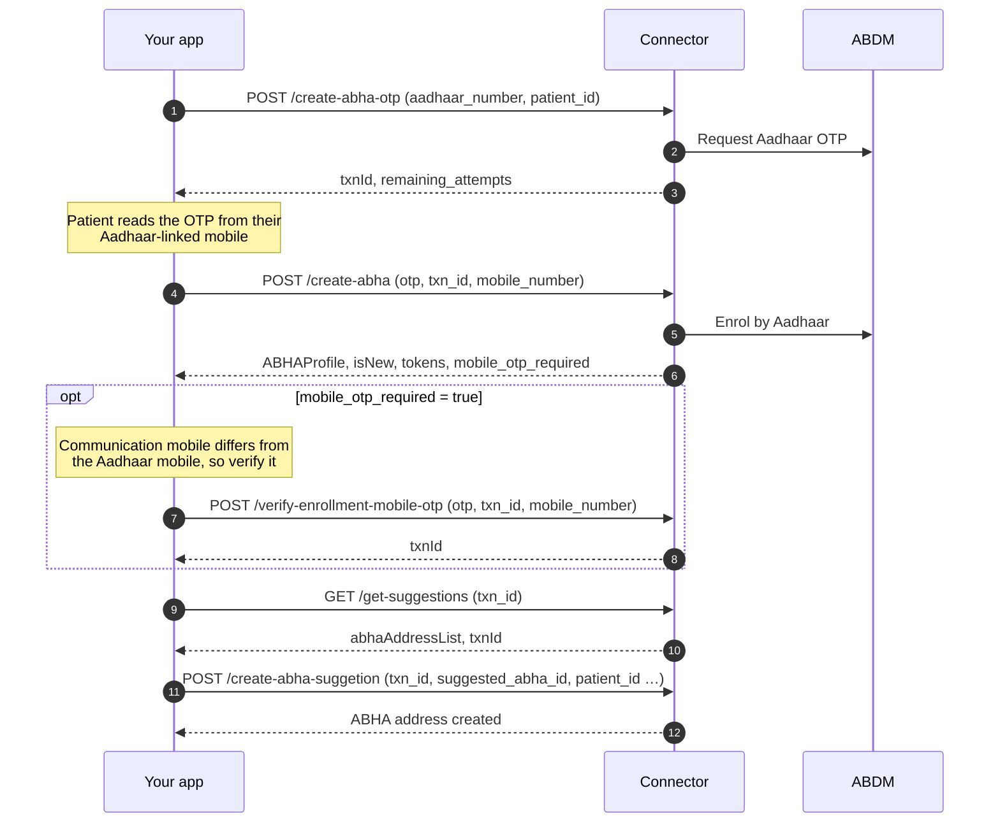

# Create ABHA using Aadhaar OTP

Creates a new ABHA number for a patient, or **returns the existing one** if this Aadhaar already has an ABHA. The patient receives an OTP on their Aadhaar-linked mobile number.

**Before you start:** the patient exists in the connector (`patient_id`) and has [given consent](/m1/consent).

## Sequence



All paths below are relative to `/abha/M1`. Every parameter is a **query parameter**.

## Step 1 · Send Aadhaar OTP {#step-1}

<EndpointBadge method="POST" path="/abha/M1/create-abha-otp" />

| Parameter | Required | Description |
|---|---|---|
| `aadhaar_number` | yes | 12-digit Aadhaar number, digits only |
| `patient_id` | recommended | Patient to create the ABHA for |

**Response `data[0]`**

```json
{ "txnId": "6c1b5f0a-…", "attempts": 1, "remaining_attempts": 2 }
```

Keep `txnId` for step 2.

<ApiPlayground
  method="POST"
  path="/abha/M1/create-abha-otp"
  :params="[
    { name: 'aadhaar_number', required: true, placeholder: '12-digit sandbox Aadhaar' },
    { name: 'patient_id', placeholder: '42' },
  ]"
/>

## Step 2 · Verify OTP and enrol {#step-2}

<EndpointBadge method="POST" path="/abha/M1/create-abha" />

| Parameter | Required | Description |
|---|---|---|
| `otp` | yes | 6-digit OTP the patient received |
| `txn_id` | yes | `txnId` from step 1 |
| `mobile_number` | recommended | Mobile number the patient wants for ABHA communication. If it differs from the Aadhaar-linked number, the connector sends an OTP to it (see step 3). |

**Response `data[0]`**

| Field | Description |
|---|---|
| `ABHAProfile` | Name, gender, DOB, address, photo, `ABHANumber`, `phrAddress[]`, `preferredAddress` |
| `isNew` | `true` = a new ABHA was created. `false` = this Aadhaar **already had** an ABHA, and the existing one was returned. |
| `tokens.token` | ABHA user token. Keep it for the [ABHA card](/m1/abha-card) and [demographic check](/m1/link-patient#_1-compare-demographics). |
| `txnId` | Enrolment transaction, used for step 4 |
| `mobile_otp_required` | `true` = an OTP was sent to `mobile_number`. Do step 3 before step 4. |
| `txn_id` | Only when `mobile_otp_required` is `true`: the transaction for step 3 |

::: tip When `isNew` is false
The patient already has an ABHA. Show them the existing ABHA number and address. Don't create a new address. Go straight to [linking](/m1/link-patient).
:::

<ApiPlayground
  method="POST"
  path="/abha/M1/create-abha"
  :params="[
    { name: 'otp', required: true, placeholder: '123456' },
    { name: 'txn_id', required: true, placeholder: 'txnId from step 1' },
    { name: 'mobile_number', placeholder: '10-digit mobile' },
  ]"
/>

## Step 3 · Verify the communication mobile (conditional) {#step-3}

Only needed when step 2 returned `mobile_otp_required: true`.

<EndpointBadge method="POST" path="/abha/M1/verify-enrollment-mobile-otp" />

| Parameter | Required | Description |
|---|---|---|
| `otp` | yes | OTP sent to the communication mobile |
| `txn_id` | yes | `txn_id` from step 2 |
| `mobile_number` | recommended | Same mobile number as in step 2 |

Returns `data[0].txnId`. Use it in step 4.

**Resend the mobile OTP**

<EndpointBadge method="POST" path="/abha/M1/enroll-mobile-otp" />

| Parameter | Required |
|---|---|
| `aadhaar_number` | yes |
| `mobile_number` | yes |

## Step 4 · Get ABHA address suggestions {#step-4}

<EndpointBadge method="GET" path="/abha/M1/get-suggestions" />

| Parameter | Required | Description |
|---|---|---|
| `txn_id` | yes | `txnId` from step 2 (or step 3 if you did it) |

**Response `data[0]`**

```json
{ "txnId": "9f2e…", "abhaAddressList": ["ravikumar1990", "ravi.kumar90", "kumar_ravi12"] }
```

## Step 5 · Create the ABHA address {#step-5}

The patient picks a suggestion or types their own address.

<EndpointBadge method="POST" path="/abha/M1/create-abha-suggetion" />

::: info Spelling
The path really is `create-abha-suggetion`, with the original spelling.
:::

| Parameter | Required | Description |
|---|---|---|
| `txn_id` | yes | `txnId` from step 4 |
| `suggested_abha_id` | yes | Chosen address, without the `@sbx` / `@abdm` suffix |
| `patient_id` | recommended | Patient to link the address to |
| `full_name` | no | Name to store on the patient |
| `dob` | no | `DD-MM-YYYY`, `YYYY-MM-DD` or `DD/MM/YYYY` |
| `gender` | no | `M`, `F`, `O`, `Male`, `Female`, `Other` |

**ABHA address rules.** The connector checks these before calling ABDM, so you can validate the same rules in your form:

- 8–18 characters
- letters, digits, `.` and `_` only, with at most one `.` and one `_`
- must start and end with a letter or digit
- must contain **both** letters and digits

```js
function validateAbhaAddress(a) {
  if (a.length < 8 || a.length > 18) return 'Must be 8–18 characters'
  if (!/^[a-zA-Z0-9._]+$/.test(a)) return 'Only letters, digits, . and _'
  if (!/^[a-zA-Z0-9].*[a-zA-Z0-9]$/.test(a)) return 'Must start and end with a letter or digit'
  if ((a.match(/\./g) || []).length > 1 || (a.match(/_/g) || []).length > 1) return 'At most one . and one _'
  if (/^\d+$/.test(a) || /^[a-zA-Z]+$/.test(a)) return 'Use both letters and digits'
  return null
}
```

## Next

[Link the ABHA to the patient](/m1/link-patient), then [download the ABHA card](/m1/abha-card).
