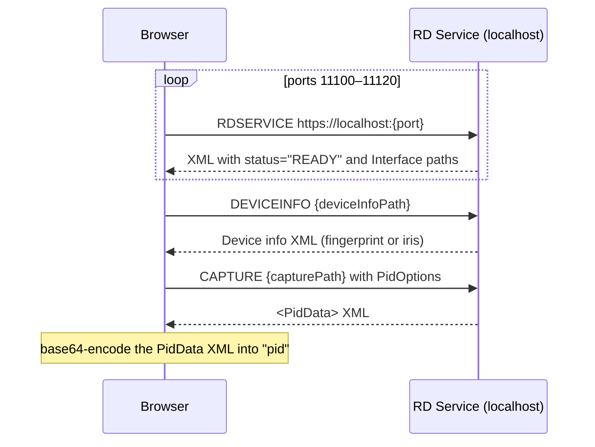
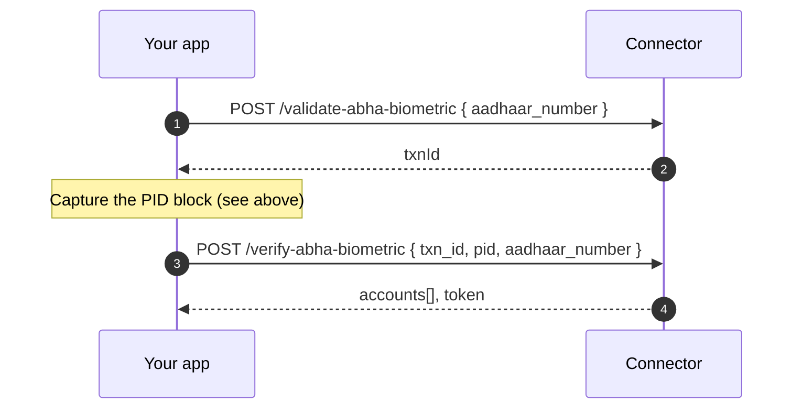

# Create or verify ABHA using biometric

Use biometric (fingerprint or iris) authentication when the patient can't receive an OTP, for example when their Aadhaar-linked mobile number is lost or inactive.

The fingerprint is captured **on the client machine** by a UIDAI-certified **RD Service** device. The connector receives only the encrypted PID block, which it forwards to ABDM.

## Requirements

- A UIDAI-registered biometric device (e.g. Mantra, Morpho, Startek) with its **RD Service** running on the same machine as the browser
- RD Service listens on `https://localhost:<port>`, with port 11100–11120
- The page must be served over **HTTPS**, and the browser must trust the RD Service's localhost certificate

## Capture the PID block (client side)



RD Service uses the custom HTTP methods `RDSERVICE`, `DEVICEINFO` and `CAPTURE`. ABHA enrolment also requires a **`wadh`** value in `PidOptions`:

```js
import CryptoJS from 'crypto-js'

// wadh = base64(sha256("2.5" + ra + rc + lr + de + pfr))
// ra = "F" (fingerprint) or "I" (iris); rc, lr = "Y"; de, pfr = "N"
const ra = deviceInfoXml.toUpperCase().includes('IRIS') ? 'I' : 'F'
const wadh = CryptoJS.enc.Base64.stringify(CryptoJS.SHA256(`2.5${ra}YYNN`))

const pidOptions = `
<PidOptions ver="1.0">
  <Opts env="P" fCount="1" fType="2" format="0" pidVer="2.0"
        timeout="10000" wadh="${wadh}" posh="UNKNOWN" />
</PidOptions>`

const pidXml = await new Promise((resolve, reject) => {
  const xhr = new XMLHttpRequest()
  xhr.open('CAPTURE', `https://localhost:${port}${capturePath}`, true)
  xhr.onload = () =>
    xhr.status === 200 && xhr.responseText.includes('<PidData')
      ? resolve(xhr.responseText)
      : reject(new Error('Invalid PID data'))
  xhr.onerror = () => reject(new Error('Capture failed. Check RD Service permissions.'))
  xhr.send(pidOptions)
})

const pid = btoa(pidXml) // send this as "pid"
```

::: warning
Check the PID XML for an error code (`<Resp errCode="0">` means success) before you send it. Never store PID data. It contains encrypted biometric data.
:::

## Create ABHA with biometric

<EndpointBadge method="POST" path="/abha/M1/create-abha-biometric" />

**JSON body**

```json
{
  "aadhaar_number": "123412341234",
  "mobile_number": "9876543210",
  "pid": "PFBpZERhdGE+…"
}
```

| Field | Required | Description |
|---|---|---|
| `aadhaar_number` | yes | 12-digit Aadhaar |
| `mobile_number` | yes | Communication mobile for the ABHA |
| `pid` | yes | Base64-encoded `PidData` XML from the capture step |

The response has the **same shape as [`create-abha`](/m1/create-aadhaar-otp#step-2)** (`ABHAProfile`, `isNew`, `tokens`, `txnId`, `mobile_otp_required`, `txn_id`). Continue from **step 3** of the Aadhaar OTP flow: verify the mobile if required, then get suggestions and create the address.

<ApiPlayground
  method="POST"
  path="/abha/M1/create-abha-biometric"
  :body="{ aadhaar_number: '', mobile_number: '', pid: '' }"
/>

## Verify an existing ABHA with biometric

Use this to find and authenticate a patient's existing ABHA without an OTP.



### 1. Start the transaction

<EndpointBadge method="POST" path="/abha/M1/validate-abha-biometric" />

```json
{ "aadhaar_number": "123412341234" }
```

Send `aadhaar_number` **or** `abha_number`. Returns `data[0].txnId`.

### 2. Submit the fingerprint

<EndpointBadge method="POST" path="/abha/M1/verify-abha-biometric" />

```json
{
  "txn_id": "6c1b5f0a-…",
  "pid": "PFBpZERhdGE+…",
  "aadhaar_number": "123412341234"
}
```

**Response `data[0]`**

| Field | Description |
|---|---|
| `accounts[]` | ABHA accounts for this Aadhaar (`ABHANumber`, `name`, `preferredAbhaAddress`, …) |
| `token` | ABHA user token. Use it for the [demographic check](/m1/link-patient) and the [ABHA card](/m1/abha-card). |

Then [link the ABHA to your patient](/m1/link-patient).
