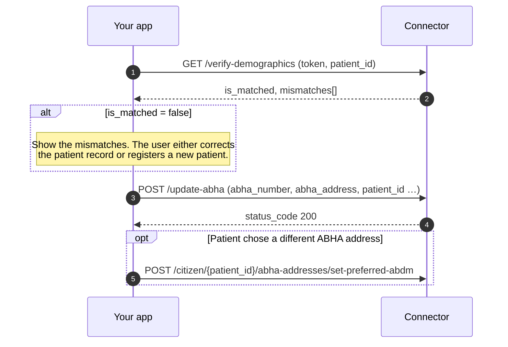

# Link ABHA to a patient

After you've created or verified an ABHA, attach it to the patient record. ABDM requires you to **check that the ABHA's details match the patient** before you link them, so the wrong person's health records don't end up attached.



## 1. Compare demographics {#_1-compare-demographics}

<EndpointBadge method="GET" path="/abha/M1/verify-demographics" />

| Parameter | Required | Description |
|---|---|---|
| `token` | yes | ABHA user token from the create or verify step (`tokens.token` or `token`) |
| `patient_id` | yes | Your patient |

The connector compares **name, gender, date of birth, mobile, ABHA number and ABHA address** between the patient record and the ABHA profile.

**Response `data[0]`**

```json
{
  "citizen_id": 42,
  "is_matched": false,
  "mismatch_count": 1,
  "mismatches": [
    { "field": "dob", "db": "1990-01-02", "abha": "01-01-1990", "is_matched": false }
  ],
  "abha_address_match": { "name": "…", "dob": "…", "is_match": true },
  "mobile_demographics_match": { "name": "…", "dob": "…", "is_match": false }
}
```

| Field | Description |
|---|---|
| `is_matched` | `true` when every field matches. You can link the ABHA. |
| `mismatches[]` | Each field that differs: `field`, the patient-record value (`db`), and the ABHA value (`abha`) |
| `abha_address_match` | Values from the **patient record** |
| `mobile_demographics_match` | Values from the **ABHA profile** |

::: warning Handling a mismatch
Don't link silently. Show both values side by side and let the user choose:
- **Update the patient record** with the ABHA values, then link, or
- **Register a new patient** if this ABHA belongs to someone else.
:::

<ApiPlayground
  method="GET"
  path="/abha/M1/verify-demographics"
  :params="[
    { name: 'token', required: true, placeholder: 'ABHA user token' },
    { name: 'patient_id', required: true, placeholder: '42' },
  ]"
/>

## 2. Link the ABHA

<EndpointBadge method="POST" path="/abha/M1/update-abha" />

| Parameter | Required | Description |
|---|---|---|
| `abha_number` | yes | 14-digit ABHA number |
| `abha_address` | yes | ABHA address to set as the patient's primary address |
| `patient_id` | yes | Your patient |
| `mobile_verified` | no | `mobileVerified` from the ABHA account |
| `full_name` | no | Updates the patient's name to match the ABHA |
| `dob` | no | `DD-MM-YYYY`, `YYYY-MM-DD` or `DD/MM/YYYY` |
| `gender` | no | `M`, `F`, `O`, `Male`, `Female`, `Other` |

Returns `status_code: 200` with an empty `data`.

| `status_code` | Meaning |
|---|---|
| `404` | `patient_id` not found |
| `409` | This ABHA address is already linked to **another** patient |
| `400` | Invalid `dob` or `gender` format, or an empty ABHA number/address |

<ApiPlayground
  method="POST"
  path="/abha/M1/update-abha"
  :params="[
    { name: 'abha_number', required: true, placeholder: '91-1234-5678-9012' },
    { name: 'abha_address', required: true, placeholder: 'ravikumar1990@sbx' },
    { name: 'patient_id', required: true, placeholder: '42' },
    { name: 'mobile_verified', placeholder: 'true' },
  ]"
/>

## 3. Change the preferred ABHA address (optional)

A patient can have several ABHA addresses. This call sets which one is **preferred on ABDM** and updates the patient record to match.

<EndpointBadge method="POST" path="/abha/M1/citizen/{citizen_id}/abha-addresses/set-preferred-abdm" />

| Parameter | In | Required | Description |
|---|---|---|---|
| `citizen_id` | path | yes | Same value as `patient_id` |
| `abha_address` | query | yes | Address to make preferred |
| `login_token` | query | recommended | ABHA user token. If you don't send one, the connector uses the token it has stored for the patient. |

Returns `409` if the address is linked to a different patient.

## List a patient's ABHA addresses

<EndpointBadge method="GET" path="/abha/M1/citizen/{citizen_id}/abha-addresses" />
