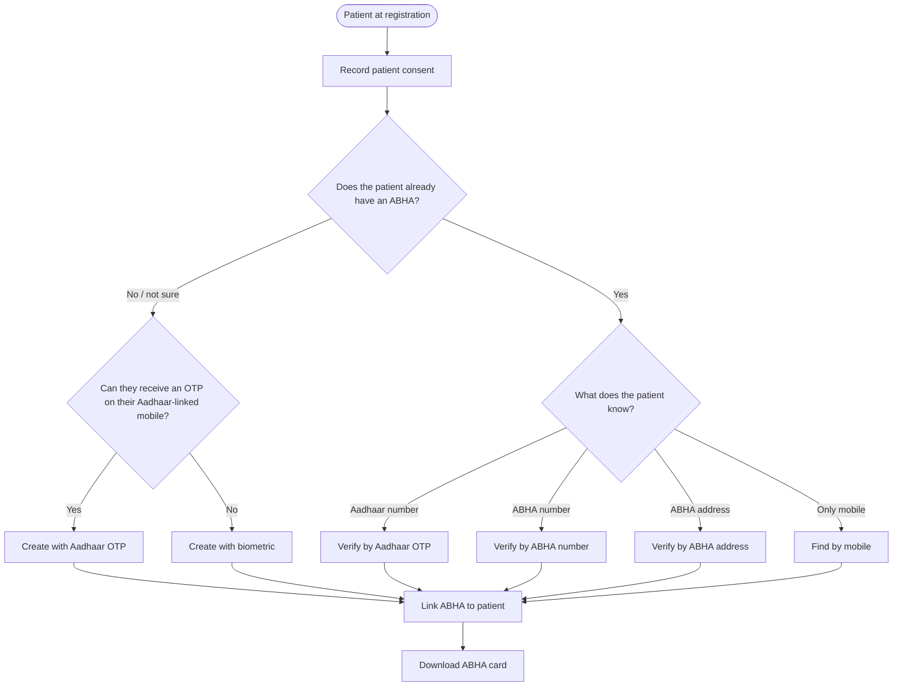

# M1 · ABHA overview

M1 gives a patient an **ABHA** (Ayushman Bharat Health Account) and links it to the patient record in your system. A patient has:

- an **ABHA number**: a 14-digit ID, e.g. `91-1234-5678-9012`
- one or more **ABHA addresses**: a readable handle such as `ravi.kumar@sbx` (sandbox) or `ravi.kumar@abdm` (production)

All M1 endpoints are under:

```
/abha/M1
```

## Which flow do I need?



| Step | Page |
|---|---|
| 1. Record consent | [Patient consent](/m1/consent) |
| 2a. Create a new ABHA | [Aadhaar OTP](/m1/create-aadhaar-otp) · [Biometric](/m1/create-biometric) |
| 2b. Find an existing ABHA | [Verify existing ABHA](/m1/verify-abha) |
| 3. Attach it to your patient | [Link ABHA to a patient](/m1/link-patient) |
| 4. Give the patient their card | [ABHA card](/m1/abha-card) |

## Things every M1 flow has in common

**Patients are identified by `patient_id`.** This is the ID of the patient record in the connector. Create the patient first, then pass `patient_id` so the connector can save the ABHA, tokens and audit trail against that patient.

**Parameters go in the query string.** Unless a page says *JSON body*, M1 `POST` endpoints read their inputs from **query parameters**, not from a JSON body:

```bash
curl -X POST "$BASE/abha/M1/create-abha-otp?aadhaar_number=123412341234&patient_id=42" \
  -H "Authorization: Bearer $TOKEN"
```

**Each step returns a `txnId`.** Pass it to the next step as `txn_id`. See [Transaction IDs](/guide/response-format#transaction-ids).

**OTP attempts are limited.** Each identifier (Aadhaar, ABHA number, mobile) gets **3 OTP requests in any rolling 24 hours**. OTP responses include `attempts` and `remaining_attempts`. When none remain, the connector returns `status_code: 429`. Warn the user before they use their last attempt.

**Never log or store raw Aadhaar numbers or OTPs** in your own system. The connector encrypts them before sending them to ABDM. Your application should keep them in memory only for the current request.
