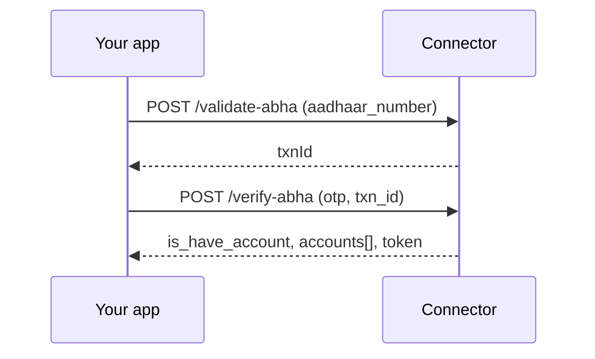
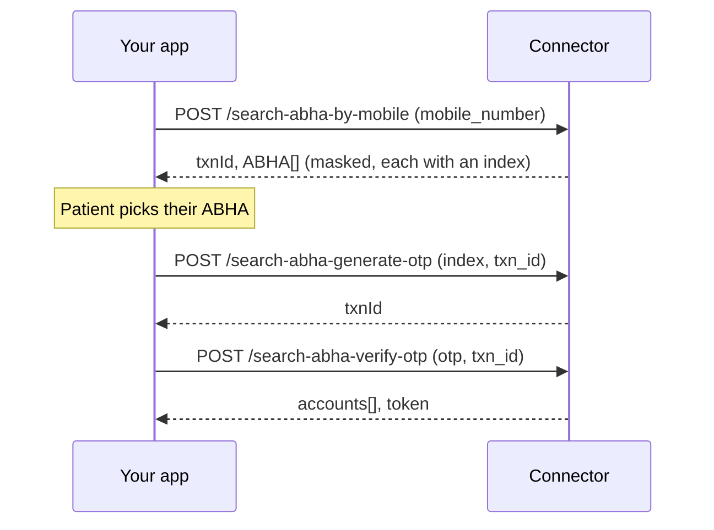

# Verify an existing ABHA

Use this when the patient **already has an ABHA**. The patient proves they own it with an OTP, and you get their ABHA profile and a **user token** you can use to [link the ABHA to your patient](/m1/link-patient).

Pick a method based on what the patient knows:

| Patient knows | OTP goes to | Endpoints |
|---|---|---|
| [Aadhaar number](#by-aadhaar) | Aadhaar-linked mobile | `validate-abha` → `verify-abha` |
| [ABHA number](#by-abha-number) | ABHA mobile or Aadhaar mobile | `abha-number/request-otp` → `verify-abha` |
| [ABHA address](#by-abha-address) | ABHA mobile or Aadhaar mobile | `abha-address/request-otp` → `abha-address/verify-otp` |
| [Only their mobile number](#by-mobile) | That mobile | `search-abha-by-mobile` → `search-abha-generate-otp` → `search-abha-verify-otp` |
| No OTP possible | — | [Biometric verification](/m1/create-biometric#verify-an-existing-abha-with-biometric) |

All paths are relative to `/abha/M1`, and all parameters are **query parameters**.

## By Aadhaar number {#by-aadhaar}



### Send OTP

<EndpointBadge method="POST" path="/abha/M1/validate-abha" />

| Parameter | Required | Description |
|---|---|---|
| `aadhaar_number` | yes | 12-digit Aadhaar |

Returns `data[0].txnId`, `attempts`, `remaining_attempts`.

<ApiPlayground
  method="POST"
  path="/abha/M1/validate-abha"
  :params="[{ name: 'aadhaar_number', required: true, placeholder: '12-digit sandbox Aadhaar' }]"
/>

### Verify OTP {#verify-otp}

<EndpointBadge method="POST" path="/abha/M1/verify-abha" />

| Parameter | Required | Description |
|---|---|---|
| `otp` | yes | OTP the patient received |
| `txn_id` | yes | `txnId` from the previous call |

**Response `data[0]`**

```json
{
  "is_have_account": true,
  "token": "eyJhbGciOi…",
  "accounts": [
    {
      "ABHANumber": "91-1234-5678-9012",
      "preferredAbhaAddress": "ravikumar1990@sbx",
      "name": "Ravi Kumar",
      "gender": "M",
      "dob": "01-01-1990",
      "profilePhoto": "…",
      "mobileVerified": true
    }
  ]
}
```

| Field | Description |
|---|---|
| `is_have_account` | `false` = no ABHA exists for this Aadhaar. Offer to [create one](/m1/create-aadhaar-otp). |
| `accounts[]` | One or more ABHAs. If there are several, ask the patient which one to use. |
| `token` | ABHA user token for the [demographic check](/m1/link-patient#_1-compare-demographics) and the [ABHA card](/m1/abha-card) |

<ApiPlayground
  method="POST"
  path="/abha/M1/verify-abha"
  :params="[
    { name: 'otp', required: true, placeholder: '123456' },
    { name: 'txn_id', required: true },
  ]"
/>

## By ABHA number {#by-abha-number}

<EndpointBadge method="POST" path="/abha/M1/abha-number/request-otp" />

| Parameter | Required | Description |
|---|---|---|
| `abha_number` | yes | 14-digit ABHA number, with or without hyphens |
| `otp_method` | no | `mobile` (default: the ABHA-registered mobile) or `aadhaar` (the Aadhaar-linked mobile) |

Returns `data[0].txnId`. Then call [`verify-abha`](#verify-otp) with the OTP and `txn_id`. The response is the same.

<ApiPlayground
  method="POST"
  path="/abha/M1/abha-number/request-otp"
  :params="[
    { name: 'abha_number', required: true, placeholder: '91-1234-5678-9012' },
    { name: 'otp_method', placeholder: 'mobile | aadhaar' },
  ]"
/>

## By ABHA address {#by-abha-address}

### Send OTP

<EndpointBadge method="POST" path="/abha/M1/abha-address/request-otp" />

| Parameter | Required | Description |
|---|---|---|
| `abha_address` | yes | Full address **including the suffix**, e.g. `ravikumar1990@sbx` (sandbox) or `@abdm` (production) |
| `otp_method` | yes | `MOBILE_OTP` or `AADHAAR_OTP` |

Returns `data[0].txnId`.

### Verify OTP

<EndpointBadge method="POST" path="/abha/M1/abha-address/verify-otp" />

| Parameter | Required | Description |
|---|---|---|
| `otp` | yes | OTP |
| `txn_id` | yes | `txnId` from the previous call |
| `otp_method` | yes | The same value you sent when requesting the OTP |
| `patient_id` | recommended | Saves the token against this patient |

**Response `data[0]`** is different from the other methods. Accounts are in `users[]`, with different field names:

| `users[]` field | Equivalent elsewhere |
|---|---|
| `abhaNumber` | `ABHANumber` |
| `abhaAddress` | `preferredAbhaAddress` |
| `fullName` | `name` |
| `dateOfBirth` | `dob` |
| `gender`, `mobile`, `mobileVerified`, `profilePhoto`, `status`, `address` | same |

plus `token`.

## By mobile number {#by-mobile}

A mobile number can be linked to several ABHAs, so this flow has three steps.



### 1. Search

<EndpointBadge method="POST" path="/abha/M1/search-abha-by-mobile" />

| Parameter | Required |
|---|---|
| `mobile_number` | yes |

**Response `data[0]`**: `txnId` and `ABHA[]`. Each entry has an `index`, a masked `ABHANumber`, `name` and `gender`.

### 2. Send OTP for the chosen ABHA

<EndpointBadge method="POST" path="/abha/M1/search-abha-generate-otp" />

| Parameter | Required | Description |
|---|---|---|
| `index` | yes | `index` of the ABHA the patient picked |
| `txn_id` | yes | `txnId` from the search |

### 3. Verify OTP

<EndpointBadge method="POST" path="/abha/M1/search-abha-verify-otp" />

| Parameter | Required |
|---|---|
| `otp` | yes |
| `txn_id` | yes |

The response has the same shape as [`verify-abha`](#verify-otp) (`accounts[]`, `token`). In this flow, the photo is returned as `kycPhoto`.

## Next

[Link the ABHA to your patient](/m1/link-patient).
